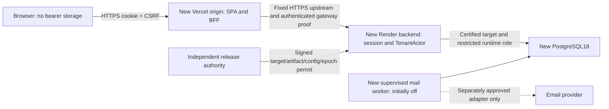

# Independent FitCore SaaS browser and startup design

4 November2026. **DRAFT — approval requested, not implementation authority.** Baseline45782b8050580036c0c9423acce90befe089ce7a. Option A (new independent SaaS/empty PostgreSQL) is owner-selected; the browser/startup mechanisms below are engineering proposals. Current guards and bearer transport are unchanged.

## Intent and constraints

Launch several gyms on one new shared PostgreSQL18 database without touching old FitCore. Preserve all V9 catalog/history behavior, membership renewal/upgrade and trainer-booking rules, actor-derived tenant isolation, enabled-primary-OWNER invariants, credential/authz revocation and secure challenge/outbox behavior. Payments, legacy import/V3, multi-gym staff and global gym-admin bypass remain out of scope. A local or synthetic PASS cannot authorize a persistent environment.

## Browser alternatives

| Dimension | A — same-origin BFF and server session (recommended) | B — existing browser bearer with additional hardening |
| --- | --- | --- |
| Credential exposure | Opaque HttpOnly cookie; no user JWT/refresh/session secret returned to JavaScript. XSS can still act during a compromised page. | local/sessionStorage JWT remains readable by same-origin script/extensions. CSP reduces attack opportunities but cannot make storage HttpOnly. No demonstrated current XSS is claimed. |
| Infrastructure | Vercel frontend plus a small fixed-upstream BFF function; HTTPS to new Render backend; backend owns durable sessions in new PG. Extra function hop, service-auth secret and monitoring cost. | Current static Vite project and direct HTTPS API; fewer components/hops. No BFF is currently implemented. |
| Origins | Browser uses one exact origin and `/api`; Vercel→Render is server traffic. Render private URL is not assumed reachable from Vercel. | Separate origins possible with exact CORS and Authorization. CORS is not backend authorization. Do not add credential cookies opportunistically. |
| Login/logout/revocation | Serialized CSRF-protected login rotates server session; logout revokes it before clearing cookie. Verification activates the account but requires explicit login. Account versions/disabled gym revoke on each request. | Login issues JWT; current logout is local-only. Production needs bounded lifetime, server revocation/logout policy and issuer/audience/key rotation. A copied token otherwise outlives logout. |
| CSRF/SameSite | Secure/HttpOnly host-only `__Host-fitcore_session`, Path=/, no Domain, SameSite=Lax; CSRF and exact-origin checks for every unsafe browser route, including login/logout/registration/reset. | Authorization is manually attached, not ambient. Keep cookie credentials false and reject cookie-based auth. XSS remains the main token-exposure concern; exact CORS and JSON/custom-header requirements still matter. |
| Tabs/session race | Cookie shared across tabs; non-secret BroadcastChannel event + focus revalidation; server session revision/generation prevents stale replies overwriting another login. | Existing generation and localStorage event checks retained; sessionStorage is tab-specific. Do not claim it provides global cross-tab logout. |
| FitCore compatibility | Replace auth adapter/storage interception, add CSRF bootstrap/logout, keep every business payload/endpoint and same principal/tenant validation. Existing tests need coordinated transport fixtures. | Smallest initial code diff, but hardening/logout/abuse/recovery gaps still need implementation and testing. |
| Rollback | Roll back to compatible cookie/BFF artifacts; session key/cookie/schema compatibility certified. Never silently fall back to browser JWT. | Compatible bearer artifacts can roll back, but never restore retired keys or old authz state. Switching modes is a new reviewed release. |

Recommendation A is based on a new origin with no existing SaaS browser users/data to migrate, an existing React auth/API seam, and already DB-backed request authorization. It removes durable script-readable credentials while preserving existing account checks. This is an inference from current source and threat goals, not an owner approval. If B is chosen, record the residual XSS/credential-theft risk and implement the complete B requirements below before launch.

OWASP recommends avoiding credentials in Web Storage and using protected cookies/BFF. HttpOnly protects cookie confidentiality but does not stop malicious same-origin script issuing actions. SameSite is defense in depth; retain token/origin checks, including login CSRF. [Session guidance](https://cheatsheetseries.owasp.org/cheatsheets/Session_Management_Cheat_Sheet.html), [CSRF guidance](https://cheatsheetseries.owasp.org/cheatsheets/Cross-Site_Request_Forgery_Prevention_Cheat_Sheet.html).

## Recommended topology and authority

The Vercel BFF mediates the browser API but stores neither user JWTs nor a separate account database. The Render backend is the session/account authority. No external identity-provider migration or framework rewrite is required. The BFF forwards only allowlisted method/path combinations, never a client URL. Its server secret is not an OWNER/ADMIN credential and never chooses a gym.

A plain external rewrite is not the full security design. Use reviewed BFF code for header filtering, fixed upstream, bounded body/deadline, no redirects and gateway proof; route `/api` ahead of the SPA fallback. Cookies and each approved Set-Cookie header must survive that hop without Domain rewriting, caching or loss. Authenticated JSON/CSV/errors and CSRF bootstrap use no-store/CDN-no-store. Cache only versioned public assets. Vercel supports external proxy routing, but this project's current config has only the SPA fallback. [Vercel rewrites](https://vercel.com/docs/routing/rewrites).

### Session contract, proposed initial policy

1. Backend generates256-bit opaque handles using SecureRandom; persist only a digest, UUID account, gym, authz/credential-version snapshot, issuance/idle/absolute expiry, revision and externally bound recovery epoch. No passwords or user JWTs in session attributes. Use a reviewed Spring Security session/CSRF integration; custom persistence adapter must avoid Java object deserialization and prove digest-only lookup. Library selection is an implementation spike within this contract, not permission to weaken it.
2. Initial proposal:30min inactivity,12h absolute lifetime, nonpersistent browser cookie; “Remember me” initially unavailable in cookie mode. Refreshing activity cannot extend the absolute expiry. Persistent remembered sessions require a later explicit policy. Expiry, rotation and concurrent-request behavior are tested with an injected clock.
3. CSRF uses the framework synchronizer-token pattern. A short-lived anonymous/preauth session obtains a token through same-origin no-store bootstrap; rotate session ID and CSRF token on explicit login. Verification/activation returns a receipt and asks the user to sign in; it never implicitly logs in or replaces an existing account session. Token is readable in memory and sent as `X-CSRF-Token`, never put in URLs, logs or analytics. An unknown/stale/missing token fails403. Logout requires CSRF and revokes before success. Session/token insertion and rotation must be atomic across application instances.
4. Exact configured public origin is authoritative. For unsafe browser calls reject wrong/null Origin and cross-site Fetch Metadata; where Origin is absent require same-origin Referer plus valid CSRF. Reject ambiguous/missing provenance in production, with explicitly tested nonbrowser webhook/service paths using their own authentication. No state-changing GET and no automatic challenge consumption on email-link navigation.
5. Per request, resolve account by UUID and apply the same fresh DB role/gym/enabled/credential/authz checks as JWT validation, plus verified-email policy, external session epoch and restored-account authentication hold. Cached session authorities never bypass these checks. Reuse TenantActor/TenantAccess; OWNER remains local, ordinary role changes cannot assign OWNER/platform powers. No app-wide ADMIN path is introduced.
6. Password/role/email/gym/disabled changes invalidate matching sessions by version. Per-session logout revokes one handle; explicit “all sessions” increments the account authorization version. Password reset revokes all prior sessions and pending account challenges, preserving current atomicity. A server rejection triggers authoritative session revalidation; only the matching current session may clear UI state, and a stale response cannot clear a newer login. User identity caches remain namespaced and never authorize.
7. Cross-tab messages contain only a non-secret “session changed” event. Every receiving tab calls me/bootstrap and clears old training/user state, including on focus. No cookie/session/CSRF/token is broadcast or written to Web Storage. Server rotation makes old in-flight responses invalid; client generation checks and an opaque non-secret revision reject stale data. Only the explicit serialized login/logout transitions may write the authentication cookie. JavaScript generation checks alone cannot stop a browser applying Set-Cookie; use the transition rules below.
8. Raw invitation tokens currently returned to an authorized issuer are sensitive. Proposed production mode returns an invitation receipt, not the secret, and delivers through outbox. Demo/manual copy-link behavior stays disposable-only; this contract change needs owner approval and tests. Verification/reset secrets remain fragment-only, scrubbed before rendering, no third-party scripts/tracking, then consumed with CSRF-protected POST. Mail delivery events never verify an account.

### Authentication-cookie transition rules

- `me`, normal API/CSRF-bootstrap responses, failed/stale requests, verification/activation and password-reset completion **never set, refresh or clear the authenticated cookie**. They may return receipt/status data. Reset revokes the affected account server-side; if another account is active in this browser, its cookie is not erased. Verification for A cannot replace login B. Anonymous CSRF bootstrap uses a distinct Secure/HttpOnly `__Host-fitcore_preauth` cookie, not the authenticated session cookie; it consumes no account challenge and changes no business data.
- Only explicit `/auth/login` and `/auth/logout` can write `__Host-fitcore_session`. Both require valid CSRF and single-use transition nonce, rotate/fence server session-family revision, and reject stale transitions without Set-Cookie. Ordinary sliding activity updates server idle time without renewing the browser cookie.
- Proposed trusted-UI ordering: use the browser Web Locks API to serialize all authentication-cookie-writing transitions across the same origin's tabs. Hold the lock through the bounded HTTP response, cookie application and authoritative `me` revalidation, then publish only a non-secret session-changed event. Backend compare-and-set does not itself order browser cookie delivery; old family handles must also become unusable server-side. Out-of-band/malicious parallel calls cannot resurrect a retired account session, even if an old cookie arrives.
- No automatic retry after login/logout transport uncertainty. Mark the transition indeterminate, abort the old request and execute a tested browser/server revalidation/refresh protocol before permitting another cookie writer. A timeout or lost tab lock is not proof that a previous Set-Cookie cannot arrive. If the protocol cannot establish safe ordering, fail closed and require a fresh clean authentication context; never display a cached identity as current. Prove cancellation/tab-crash/back-forward behavior during the D1 spike.
- MVP support requires a browser with a proven cross-tab serialization protocol; proposed baseline uses Web Locks with capability detection. Unsupported or inconclusive browser behavior disables cookie login with a clear message; no localStorage lock guess or bearer fallback. Owner approval includes this support constraint. D1 must certify the target browser matrix before launch. [Web Locks coordination model](https://developer.mozilla.org/en-US/docs/Web/API/Web_Locks_API). A different robust protocol requires review, not an implementer's silent relaxation.

This changes verified-registration UX from possible automatic login to an explicit sign-in receipt. It is a proposed owner decision, with an existing frontend “Email verified. Sign in to continue” state available, not an implemented behavior change. Initial bootstrap may set only its separate preauth cookie; no GET changes business/account ownership or consumes a challenge.

Cookie mode on the new SaaS must not emit a user bearer in auth responses or accept public browser bearer fallback. Existing disposable bearer test mode can remain explicit, isolated and never usable as a persistent bypass. Existing JWT credential-version protections remain for any approved internal/legacy-test bearer path; no insecure conversion of a JWT into a cookie with CSRF still disabled.

### Login/account policy needing approval

After every restore, default-deny fresh authentication for all restored identities until independent account recovery confirms the current password authority, enabled state, role, email and verification state. A new session epoch alone cannot prevent a new login with a rolled-back password or role. The selected conservative proposal assumes no independently durable live account journal: use a separate recovery hold (not enabled=false on the primary OWNER), and require independently signed account-reactivation receipts in the new recovery epoch. No receipt means no login even with a matching restored password. Implement this with an account-authentication epoch/hold record compared to the externally authoritative current recovery epoch, with a signed reactivation receipt for a recovered account. Normal newly verified creation may stamp the current epoch; ordinary role edits/password-reset/email flows cannot clear a restored-account hold. The recovery authority uses a distinct typed receipt/audience/key-purpose policy, so a valid release permit or gateway assertion cannot substitute for account reactivation. A future automated journal/reconciliation path requires its own review; ordinary ADMIN updates and mail to an address copied from the backup are not sufficient proof.

Require verified email on every new human login, including manager-created trainer accounts and email changes. Route pending manager-created accounts through existing verified invitation/activation semantics; preserve profile IDs/history and primary-owner constraints. Apply the secure12–64-character/72-UTF8-byte BCrypt-compatible password policy to every password-writing path. Add login IP/account abuse budgets, generic denial and measured enumeration/timing analysis. Owner recovery needs a separate audited operator process with independent approvals; no OWNER password reset/primary-owner replacement bypass through ordinary ADMIN updates.

### XSS/CSP and gateway requirements

- React text escaping and no raw catalog HTML; approved image policy and fallback preserved. Audit dependency/lockfile/SBOM, unsafe DOM sinks, source maps and third-party scripts. No analytics on secret-fragment pages; Referrer-Policy no-referrer there and restrictive app policy. No auth values in errors, tracing, URL/query, localStorage/sessionStorage or response caching.
- Enforce CSP for SPA HTML on the **new** Vercel project. Start from default-src none, script-src self, object-src none, base-uri none, frame-ancestors none, form-action self, connect-src self and approved image/font sources. Recharts/current UI uses inline style attributes: test and document a narrow style exception rather than blindly breaking the app or allowing inline scripts/eval. Trusted Types is an evaluated additional control, not a claimed existing guarantee. Include HSTS after new TLS/domain approval, nosniff, framing denial and restrictive Permissions-Policy.
- BFF strips client Authorization, forwarding/internal/gym-selection headers and any client-supplied gateway identity; retains required Cookie/Origin/CSRF only. Do not strip tenant-forgery body/query evidence before the existing backend guard rejects it. Validate body size, content type, canonical path/query and duplicate headers; reject encoded traversal/absolute URLs, method overrides and CRLF. Bounded upstream deadline must allow existing legitimate workflows; cancellation does not prove a write rolled back. Never automatically replay a membership/booking/catalog write after timeout.
- Backend business/auth API requires authenticated gateway proof; CORS/Host/IP alone do not establish it. Recommended proof is a standard short-lived signed service assertion binding deployment, audience, method, canonical target, raw-body digest, cookie digest, trusted client IP, nonce and expiry; no user role/gym authority in it. Use an approved JOSE library, asymmetric key,≤30s expiry,≤5s clock skew and shared atomic nonce rejection. BFF signing key has a separate secret-manager scope; backend has verification keys only. Public raw-body provider webhooks and minimal health paths are separate bounded exceptions. A compromised gateway remains a high-trust service; owner accepts that boundary explicitly.

### If B is selected instead

Retain bearer-only auth and credentials=false, but require enforced CSP/DOM/dependency review, strict TLS/CORS, no token-bearing URLs/logs, issuer/audience/instance binding, key IDs/rotation, approved shorter lifetime (proposal15min), a server logout/revocation strategy and restore epoch. Do not silently add long-lived refresh tokens; choosing refresh rotation is a separate design. Without refresh, expect explicit re-login at expiry and test long form submissions safely. sessionStorage reduces persistence but does not solve XSS. Existing24h lifetime/local-only logout is not the proposed production policy. Production launch with residual script-readable credentials needs an explicit recorded security decision, not a claim of equivalence to A.

## Certified clean-SaaS startup — future design only

The current disposable-only guard stays byte-identical during this phase. A future implementation must add a typed authorization path, not a generic “allow production” boolean, database comment, environment string or preexisting test token. Define TEST_DISPOSABLE and CERTIFIED_NEW_SAAS policies with separate evidence; selecting the latter without valid authorization still fails before any database attempt.

### Trust and authorization chain

The owner names independent release/security and recovery approvers. A protected release authority verifies signed certification receipts and supplies a short-lived activation lease to the exact new workload. Root verification keys are pinned by the reviewed artifact/trust policy, not provided by the purported approval document. Use a vetted asymmetric signature envelope and strict schema/canonicalization; unknown algorithms/key IDs/duplicate fields fail. Provider environment labels alone are not cryptographic workload identity. If the chosen platform cannot securely deliver a workload-bound permit, that gate remains BLOCKED until an approved bootstrap/key-custody design exists.

The approved manifest binds:

| Binding | Required evidence |
| --- | --- |
| Instance/environment/target | New immutable instance and provider resource IDs, region, exact canonical host/port/database/schema, verified TLS peer/trust policy, permitted network path; explicit old-target exclusion |
| Workload | New Vercel/Render project/deployment identity, backend/frontend/worker artifact digests, configuration digest and policy version |
| Credentials/privileges | Approved runtime secret reference **and version**, expected session_user/current_user, role/ACL contract digest; no secret values in manifests |
| Schema | Exact migration file digests, Flyway version/type/script/checksum/success contract, approved structural fingerprint and engine version |
| Operations | Security, backup/restore, monitoring/on-call and rollback receipt IDs/hashes; named approval signatures and authorized feature scope |
| Freshness/recovery | Issued/not-before/expiry, audience, unique activation nonce, external target/recovery epoch and revocation generation |

Proposed lease renewal every5min with15min maximum validity; failure to renew blocks new business/API work and workers by expiry, readiness503. Approval/revocation/epoch state is held outside the application DB and its backups. A new start/replica needs a fresh workload-bound lease; replayed old permits cannot start a restored/copy target. No unlimited cached offline approval. Lease-service availability is a deliberate operational dependency needing approval; ordinary data reads/writes must not continue indefinitely merely because a load-balancer probe went red.

### Connection sequence and fail-closed requirements

1. **Before any DataSource or driver can connect:** validate manifest/signatures/workload/expiry/revocation; resolve effective Spring configuration and reject all alternate selection/credential/schema routes. Construct exactly one sealed connection descriptor from approved configuration and protected secret version. No old-production credentials/URLs are read. A valid schema hash never creates authorization.
2. **Configuration sealing:** reject Hikari JDBC URL/DataSource/JNDI/class/driver/properties, alternate username/password/schema/catalog/init SQL, multi-host/alias/service-file URLs, query `options`/currentSchema/search_path overrides, Flyway selectors/user/password/init/locations, SQL init/ORM update, unapproved profiles/config imports/JVM/CLI/env relaxed bindings and custom connection sources. Migration job gets its own separately authorized descriptor; application cannot initialize it. A pool must consume the sealed descriptor, not independently rebind properties after certification. Safe allowlisted pool timeouts/sizes are manifest-bound.
3. **Network/peer authentication:** only the signed logical endpoint may be dialed; authenticate its approved TLS identity before sending DB credentials/SQL. Reject wrong/missing CA, hostname mismatch, plaintext fallback and client-controlled SSL factory/trust-all overrides. DNS alone is not identity; provider-managed failover needs an approved trust/network policy. Metadata cannot be checked before connecting: preconnect authorization and TLS are followed by the explicit post-connect checks below, never falsely described as zero-network verification of DB contents.
4. **Actual eventual runtime connection:** verify database, effective/initial schema/search path, engine, session_user/current_user, expected roles and a controlled new-instance identity against independently attested provider resource/epoch. Database OID/name/comment/identity row or a restored copy alone is insufficient. Every pool connection uses the same target/role/schema, with rotation/reconnect tests.
5. **Schema/ACL certification:** current clean base must be exactly V1,V2,V4–V9 with the certifiedV9 fingerprint; independently check checksum/type/script values from the signed artifact. Do not createV3, repair checksums or accept unknown objects. Certify full effective grants/memberships/default ACLs/owners/functions and sequence options separately from the structural hash. Future approved session/webhook/receipt tables require new additive migrations and newly independently certified exact contracts; do not accept arbitrary new hashes through configuration or editV1–V9.
6. **Runtime readiness and continued authority:** ORM validate, SQL init never, application Flyway off, S3 off, disposable/demo flags off, expected browser/gateway mode and only approved provider feature state. Current readiness rejects a real provider; extend it with explicit certified mode rules in the future, retaining all negative checks. It cannot be made universally true. Drift/permission/target/lease failure stops protected requests and worker claims; no in-memory bypass or owner override. Minimal liveness can remain UP; readiness reports only READY/NOT_READY.
7. **First initialization is separate:** an explicitly authorized one-shot migration job proves no application objects/users/customer rows/unknown history on the new target, runs versioned migrations with schema-owner authority, validates checksums, revokes migration privilege from runtime and issues a certification receipt. The application never infers “empty” from missing users and migrates itself. Repeated migration job is validated no-op or rejected under its lease; destructive clean/baseline/repair is not an automatic recovery action.

Authenticated PostgreSQL TLS is mandatory in this proposal. The [infrastructure TLS gate](../../phase9d-infrastructure-configuration.md) records the verified Render internal-connection limitation and the still-unapproved endpoint/trust choices. A successful future certificate/connectivity drill is required; do not silently downgrade verification.

### Required local adversarial tests

| Test class | Required rejection / positive evidence |
| --- | --- |
| Target selection | Old/unknown host, DB/schema alias, multi-host URL, nested/property/JNDI/env/CLI selector, Hikari credential/schema/init override: **zero DB attempts** before trusted authorization. |
| Approval forgery/replay | Self-signed/unknown-key/alg-none/wrong audience, altered artifact/config/secret version, expired/future/duplicate nonce, copied restore permit and revoked epoch: zero DB attempts. Include legitimate new replica with new nonce. |
| Peer authentication | Wrong CA/host/expired cert/trust-all property/plaintext downgrade rejected at TLS, no DB credentials or SQL sent to unauthenticated peer. A TLS test necessarily makes a TCP attempt; do not assert zero network here. |
| Valid lookalike DB | CorrectV9 schema on a different synthetic target, copied identity row/comment, wrong session/current user/schema/role or changed credentials: no ready/business access. |
| Schema/ACL drift | Edited checksum/type/script/history, unknown table/default/CHECK, disabled owner/immutability triggers, FK drift, excessive memberships/default grants/TRUNCATE/sequence UPDATE/helper EXECUTE: fail closed. |
| Restore/reconnect | Old valid dump/permit/epoch/key data, changed provider resource, replacement pool connection and mid-run lease expiry: old sessions/challenges/claims fail. Fresh login using restored old password/enabled/role/email state also fails until independently reactivated; fresh certified synthetic recovery succeeds. |
| Cookie/browser | Host/Domain/path/SameSite flags, fixation, login/logout CSRF, sibling-domain requests, forbidden origins, duplicate headers, missing gateway proof, stale Set-Cookie/late responses, cross-tab reset/role/gym changes: deny without cross-gym effects. |
| Business preservation | Both gyms independently create/publish/archive/catalog/log; membership renewal/upgrade races and trainer booking conflicts retain existing outcomes through browser→BFF→API→disposablePG. No automatic replay after ambiguous timeout. |

No new persistent startup, transport code, schema migration or test implementation is authorized by this document. The [ordered milestones](../../phase9d-implementation-milestones.md) separate local implementation approval from target provisioning, migration, recovery certification, deployment and actual email/public activation.
